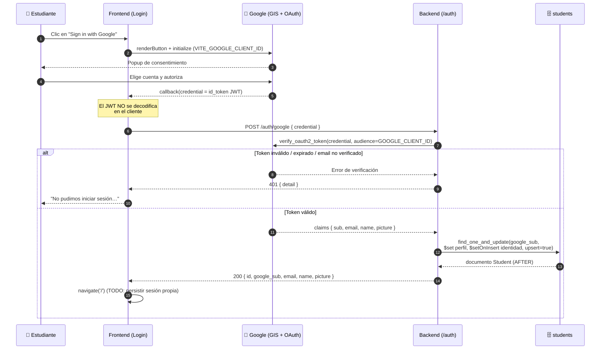
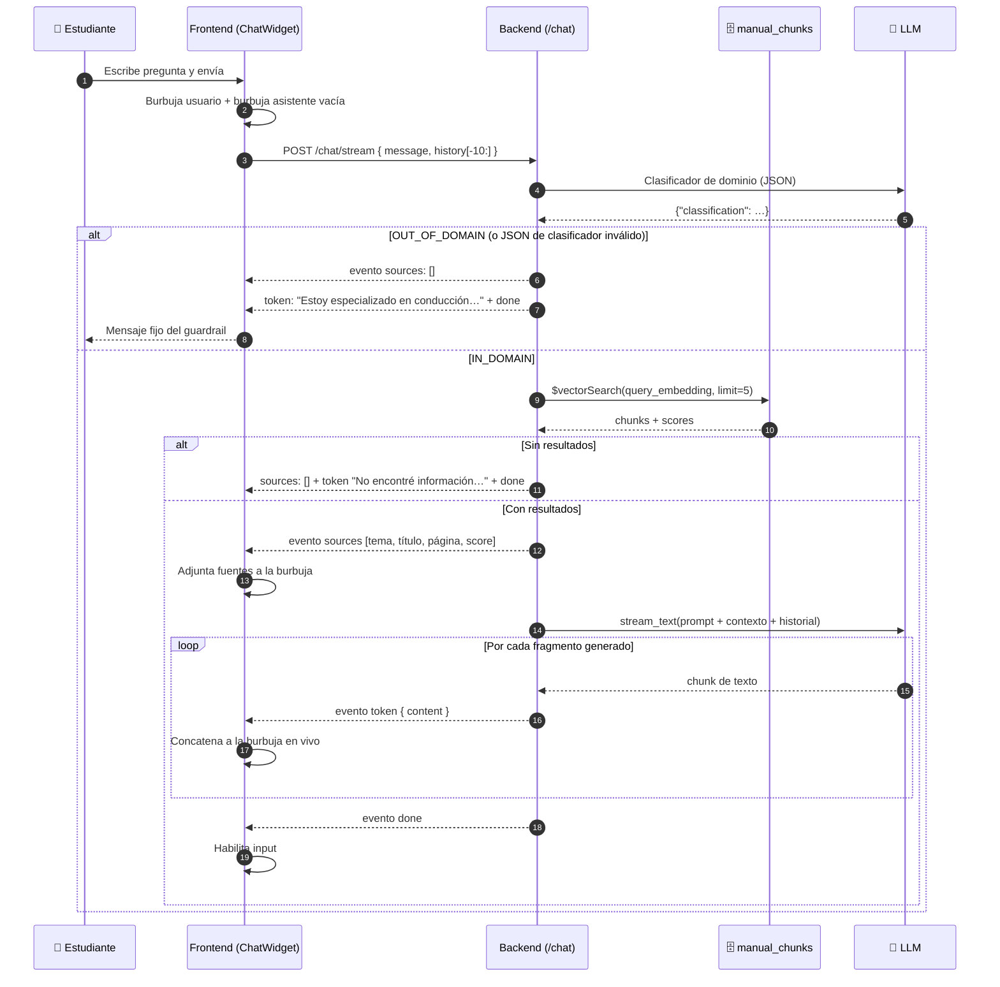
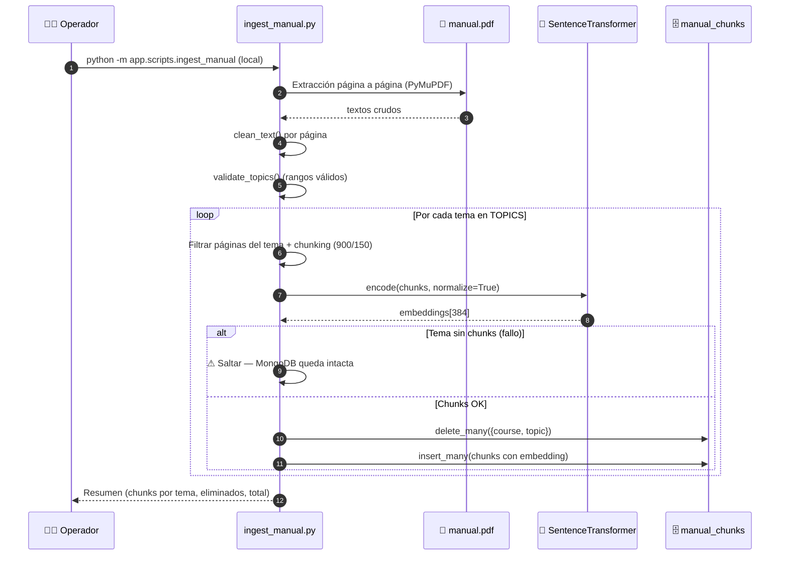
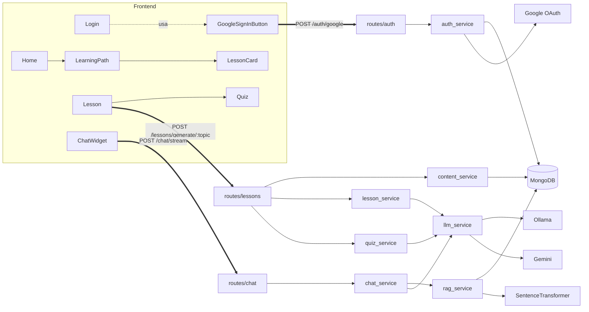

# 07 · Flujos End-to-End

> [← Volver al índice](./README.md)

Diagramas de secuencia de los cuatro flujos principales del sistema, desde la acción del usuario hasta la persistencia. Actores abreviados:

- **👤** Estudiante · **FE** Frontend (React) · **BE** Backend (FastAPI)
- **🗄️** MongoDB Atlas · **🤖** LLM (Ollama/Gemini) · **🔐** Google

---

## 7.1 Flujo de autenticación con Google



**Puntos clave:**
- La verificación criptográfica ocurre **solo en backend** (firma + audiencia + expiración + `email_verified`).
- `google_sub` es la clave de identidad inmutable; el perfil se actualiza en cada login.
- El mismo endpoint sirve para registro (primer login) y login recurrente (upsert).

---

## 7.2 Flujo de contenido publicado y quiz

La lección se genera durante el ciclo offline del worker; el frontend lee su versión publicada y solicita por separado tres preguntas del pool publicado. Las peticiones del estudiante no generan preguntas ni llaman al LLM para crear el pool.

```mermaid
sequenceDiagram
    autonumber
    participant U as 👤 Estudiante
    participant FE as Frontend (Lesson.tsx)
    participant BE as Backend (/lessons)
    participant DB as 🗄️ MongoDB
    participant LLM as 🤖 LLM
    participant Worker as ⚙️ content-worker

    rect rgb(245, 245, 245)
        Note over Worker,DB: Preparación offline, previa al acceso del estudiante
        Worker->>DB: Leer manual_chunks y configuración del tema
        Worker->>Worker: Generar y verificar lecciones y pool de preguntas
        Worker->>DB: Guardar release en ready
        Worker->>DB: Validar y publicar release; actualizar content_catalog
    end
    U->>FE: Abre clase (C1.2)
    FE->>FE: Busca clase en course.ts
    FE->>BE: POST /lessons/generate/C1.2
    BE->>DB: Resolver release publicado y leer lección standard
    DB-->>BE: Lección + fuentes
    BE-->>FE: 200 { topic, lesson, sources }
    FE->>FE: Renderiza lección + fuentes citadas
    U->>FE: Clic "Tomar quiz"
    FE->>BE: POST /lessons/C1.2/quiz
    BE->>DB: Resolver release activo y seleccionar preguntas publicadas verificadas
    alt No hay release o pool elegible insuficiente
        BE-->>FE: 503; generar/publicar pool con content-worker
    else Pool disponible
        BE->>DB: Guardar sesión con release_id y preguntas asignadas
        BE-->>FE: quiz { sessionId, questions }
        FE->>FE: Monta <Quiz/> con exerciseId
        U->>FE: Responde las 3 preguntas
        FE->>BE: POST /students/me/quiz-answer (por pregunta)
        BE->>DB: Corregir contra ejercicio asignado
        FE->>BE: POST /students/me/quiz-results
        BE->>DB: Actualizar mastery y finalizar sesión
    end
```

**Puntos clave:**
- El worker genera preguntas RAG y las deja en `ready`; la validación y publicación las hacen elegibles para el estudiante.
- Las **fuentes** (páginas del manual) viajan deduplicadas para citación en la UI.
- El endpoint online asigna solamente preguntas del release activo, verificadas y publicadas; no invoca al LLM.
- El backend corrige las respuestas usando el pool persistido; el cliente solo envía `exerciseId` y `selectedIndex`.

---

## 7.3 Flujo del chat tutor (streaming)



**Puntos clave:**
- Protocolo NDJSON: un JSON por línea; el frontend despacha por `type` (`sources`, `token`, `done`, `error`).
- **Doble recorte de historial**: el widget envía máx. 10 y el servidor vuelve a recortar (defensa en profundidad).
- Las respuestas del guardrail y de "sin contexto" **no gastan generación**: viajan como un único token.
- Cabeceras anti-buffering para que los tokens lleguen en tiempo real.

---

## 7.4 Flujo offline de ingesta del manual

Proceso operativo ejecutado a mano por el equipo (no forma parte del runtime de los contenedores):



**Post-requisito manual:** el índice `vector_index` de Atlas Search debe existir (se crea una vez por clúster, ver [04 - Base de datos](./04-base-de-datos.md#432-índice-vectorial-se-crea-manualmente-en-atlas-fuera-del-código)).

---

## 7.5 Vista combinada: quién llama a quién



---

> **Siguiente:** [08 - Despliegue y configuración →](./08-despliegue-y-configuracion.md)
