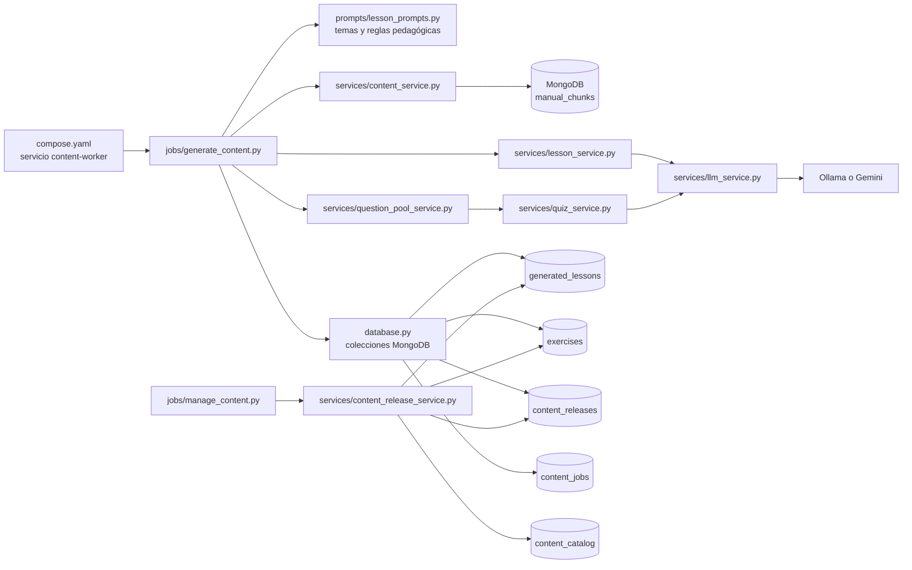
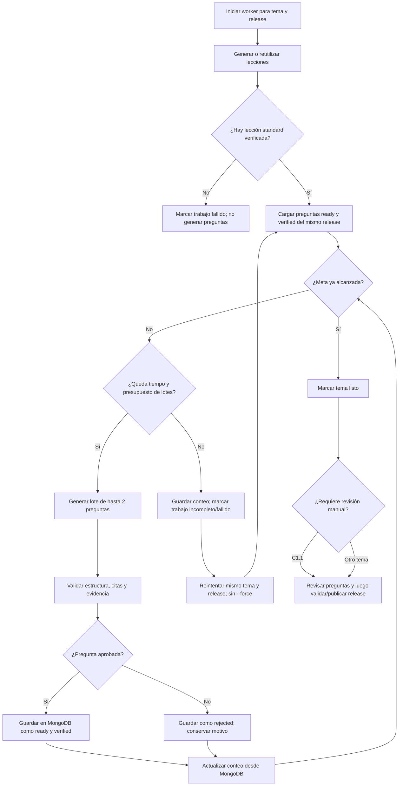

# 09 · Docker Worker de contenido pre-generado

> [← Volver al índice](./README.md)

## Explicación rápida

El **Docker Worker** es un proceso bajo demanda que prepara contenido educativo para que la aplicación lo pueda servir después sin generarlo durante la petición del estudiante. Lee de MongoDB los fragmentos del manual oficial que ya fueron cargados en `manual_chunks`, usa un proveedor LLM para crear lecciones y preguntas, valida lo generado y lo guarda asociado a una versión llamada *release*.

En términos simples:

1. `docker compose run` inicia el servicio `content-worker` con la misma imagen y configuración que el backend.
2. [`generate_content.py`](../backend/app/jobs/generate_content.py) obtiene los fragmentos del tema y la configuración pedagógica.
3. [`lesson_service.py`](../backend/app/services/lesson_service.py) genera tres variantes de lección; `quiz_service.py` y `question_pool_service.py` generan y verifican preguntas.
4. Los resultados se escriben en `generated_lessons` y `exercises`; el release y el estado de la ejecución se registran en `content_releases` y `content_jobs`.
5. La generación termina dejando contenido validado en estado `ready`. La publicación es una operación posterior, administrada por `manage_content.py`; al publicar, se actualiza `content_catalog` para que la aplicación conozca qué release debe usar.

El worker **no ingesta el PDF ni crea `manual_chunks`**: esa preparación es un proceso aparte. Tampoco se ejecuta automáticamente al iniciar `docker compose up`.

## Componentes y conexión entre ellos



El worker comparte `backend/Dockerfile`, el archivo `.env` y el montaje de `./backend:/app` con el servicio `backend`, pero ejecuta `python -m app.jobs.generate_content` en vez de iniciar FastAPI. MongoDB se configura en [`database.py`](../backend/app/database.py): ahí se crea el cliente y se declaran los nombres de las colecciones.

## Archivos de código involucrados

| Archivo | Responsabilidad en el proceso |
|---|---|
| [`compose.yaml`](../compose.yaml) | Define `content-worker`, su imagen, entorno y comando. El servicio pertenece al perfil `jobs`, por lo que no se inicia con el arranque ordinario del stack. |
| [`backend/Dockerfile`](../backend/Dockerfile) | Construye la imagen Python usada tanto por el backend como por el worker. |
| [`backend/app/jobs/generate_content.py`](../backend/app/jobs/generate_content.py) | Punto de entrada del worker: interpreta opciones, crea/recupera el release, procesa temas, genera y verifica lecciones y preguntas y registra resultados y errores. El criterio de verificación factual de lecciones se versiona aparte de la verificación de preguntas. |
| [`backend/app/prompts/lesson_prompts.py`](../backend/app/prompts/lesson_prompts.py) | Define `LESSON_SEQUENCE`, `LESSON_CONFIGS` y `BASE_LESSON_PROMPT`; los prompts fijan los objetivos pedagógicos y las reglas de fidelidad a las fuentes. |
| [`backend/app/services/content_service.py`](../backend/app/services/content_service.py) | Lee de `manual_chunks` los fragmentos del tema, ordenados por página y número de fragmento. |
| [`backend/app/services/lesson_service.py`](../backend/app/services/lesson_service.py) | Construye el contexto y prompt de la lección, llama al LLM, convierte su respuesta a JSON y normaliza/valida su forma. |
| [`backend/app/services/question_pool_service.py`](../backend/app/services/question_pool_service.py) | Coordina la generación de lotes y la persistencia/deduplicación de preguntas en `exercises`. El worker reutiliza su función `_generate_batch`. |
| [`backend/app/services/quiz_service.py`](../backend/app/services/quiz_service.py) | Genera el quiz y aporta verificadores estructurales/semánticos de preguntas y sus respuestas. |
| [`backend/app/services/llm_service.py`](../backend/app/services/llm_service.py) | Encapsula la llamada al proveedor configurado: Ollama o Gemini. |
| [`backend/app/database.py`](../backend/app/database.py) | Comparte el cliente MongoDB y declara las colecciones e índices usados por el worker. |
| [`backend/app/jobs/manage_content.py`](../backend/app/jobs/manage_content.py) | CLI administrativa: lista releases, verifica contenido heredado, gestiona la revisión manual, valida y publica. No genera el contenido normal del tema. |
| [`backend/app/services/content_release_service.py`](../backend/app/services/content_release_service.py) | Comprueba que el release tenga lección y pool suficientes; publica los documentos y actualiza el catálogo de contenido publicado. |

### Pool de preguntas disponible en el quiz online

La generación ya no ocurre en las rutas usadas por el estudiante. El worker genera las preguntas del release con el contexto RAG de `manual_chunks`, las verifica y las deja en estado `ready`; después de validar y publicar el release, `/lessons/{topic}/quiz` selecciona tres preguntas verificadas del `release_id` activo. Si el release no está publicado o no contiene al menos tres preguntas elegibles, la API devuelve `503` con un mensaje para generar/publicar contenido, sin invocar al LLM.

La verificación de lecciones contrasta sujeto, indicador, población, periodo y ubicación con los fragmentos; no considera contradictorio que las distribuciones de siniestros y fallecimientos difieran, y sí busca cambios indebidos de alcance en cifras. Los prompts de generación piden conservar esos alcances y evitar cifras hipotéticas. Cada versión de prompt y de verificador se registra en el documento generado. Una lección previamente aprobada con versiones anteriores se vuelve a generar y verificar al reintentar el mismo release; las preguntas verificadas ya guardadas se conservan.

Por ejemplo, para generar y publicar un tema:

```powershell
docker compose run --rm content-worker python -m app.jobs.generate_content --topic C1.1
docker compose run --rm content-worker python -m app.jobs.manage_content validate release-XXXXXXXXXXXX
docker compose run --rm content-worker python -m app.jobs.manage_content publish release-XXXXXXXXXXXX
```

Para `C1.1`, completa además la revisión manual requerida antes de validar/publicar. El mínimo de preguntas publicables sigue siendo 15 por defecto y se controla con `CONTENT_WORKER_MINIMUM_QUESTIONS`.

### Cómo se conectan durante una generación

1. **Selección de temas y configuración.** `generate_content.py` recibe `--topic`, `--all` o `--failed`. Para cada tema exige que exista una entrada en `LESSON_CONFIGS`.
2. **Lectura de fuentes.** Llama a `get_topic_chunks()` de `content_service.py`. Los chunks son el contenido del manual ya almacenado en `manual_chunks`; sin ellos, el tema falla.
3. **Lecciones.** Para cada tema genera las variantes `standard`, `reinforcement` y `challenge`. `lesson_service.py` combina los chunks con las instrucciones pedagógicas y pide JSON al LLM. El worker valida los campos requeridos, comprueba una correspondencia textual mínima con las fuentes y luego ejecuta un verificador LLM independiente. Para aprobar, este debe responder `approved: true` y confianza de al menos `0.85`.
4. **Preguntas.** El worker toma la lección `standard` verificada como contexto y pide preguntas a `_generate_batch()`. Se valida su estructura, se verifica que las citas correspondan literalmente a chunks del tema, se contrasta la respuesta con el manual mediante `verify_question()` y se evita guardar duplicados mediante una huella (`fingerprint`).
5. **Persistencia y estado.** Los documentos se asocian con tema, idioma, release y versiones de contenido/prompt/verificador. El trabajo por tema queda registrado en `content_jobs`. Si ocurre un error, se registra como `failed` con el tipo y mensaje; los errores no se ocultan.
6. **Publicación separada.** La generación deja los candidatos aceptados en `ready`. `manage_content.py` y `content_release_service.py` realizan la validación final y, si corresponde, la publicación a `published`.

La verificación automatizada reduce errores y conserva trazabilidad hacia las fuentes, pero no sustituye la revisión humana exigida para el tema piloto `C1.1` antes de validar su release.

## Colecciones MongoDB

La generación y su ciclo de vida se reparten entre estas colecciones. Algunas contienen contenido generado; otras controlan versiones y publicación.

| Colección | ¿Qué contiene? | ¿Quién la usa/escribe? |
|---|---|---|
| `manual_chunks` | Fragmentos preprocesados del manual: tema, título, página, índice del chunk, texto y, para el uso RAG, embedding. Es la **entrada** del worker; la generación aquí descrita no la crea ni la modifica. | `content_service.py` la lee. La ingesta del manual se realiza por separado. |
| `generated_lessons` | Hasta tres documentos por tema, idioma y release: `standard`, `reinforcement` y `challenge`. Incluye el JSON de la lección, referencias a chunks fuente (`source_chunk_ids`), versiones, indicador `verified` y estado (`generating`, `ready`, `rejected` o `published`). | `generate_content.py` crea/actualiza; el servicio de releases cambia el estado al publicar. |
| `exercises` | Banco de preguntas de opción múltiple. Incluye pregunta, alternativas, respuesta e índice correctos, explicación, tema/idioma, dificultad y etiquetas pedagógicas, huella anti-duplicados, citas (`evidence_refs`), chunks fuente, versiones, `release_id`, estado, verificación y datos de revisión. También existen otros ejercicios históricos/ajenos a este worker en la misma colección. | `question_pool_service.py` y `generate_content.py` crean/validan; las herramientas administrativas revisan o migran; el servicio de releases publica. |
| `content_releases` | Una ficha por release: identificador, `content_version`, estado, fechas y temas incluidos, además de datos de validación/revisión. Agrupa las lecciones y preguntas de una versión para no mezclar contenido de releases distintos. | `generate_content.py` crea/actualiza durante generación; `manage_content.py`/`content_release_service.py` valida, publica o sustituye. |
| `content_jobs` | Registro de cada trabajo por release y tema: estado, intentos, fechas, duración, conteos de generación/rechazo y datos de error. Su `job_id` tiene la forma `<release_id>:<topic>`, lo que permite reintentar el tema fallido. | `generate_content.py` crea/actualiza; `--failed` consulta los trabajos con error. |
| `content_catalog` | Índice pequeño del contenido **publicado**. El documento `_id: "published"` mantiene una lista `topics` con el `release_id` activo para cada tema. No contiene las lecciones ni las preguntas: apunta a ellas. | `content_release_service.py` lo actualiza transaccionalmente durante `publish`; los servicios de runtime consultan ese puntero para encontrar el release activo. |

### Estados y relación de publicación

- **Trabajo (`content_jobs.status`):** empieza en `generating`; termina como `ready` o `failed`.
- **Release (`content_releases.status`):** se crea en `building`. El worker puede marcarlo `ready` cuando se completan los temas esperados; los comandos administrativos lo hacen pasar por `validating` y luego `ready`, o mantienen los errores de validación. Después de publicar queda `published`; una versión publicada que deja de estar activa puede marcarse `superseded`.
- **Contenido (`generated_lessons.status` y `exercises.status`):** el generado y verificado queda en `ready`; la publicación lo transforma en `published`. Los elementos rechazados se conservan con sus datos de error para poder investigar el resultado.
- **Catálogo:** solamente se actualiza al publicar. Por eso crear contenido en `ready` no lo hace automáticamente visible como contenido activo para estudiantes.

El tema `C1.1` es un caso especial: sus preguntas generadas o migradas requieren revisión manual aprobada. En consecuencia, un pool con suficientes preguntas verificadas puede no bastar para publicar ese tema hasta completar la revisión requerida.

## Ejecución

Requisitos: Docker Compose, `.env` con `MONGODB_URI`, `MONGODB_DATABASE` y la configuración necesaria del proveedor LLM, acceso a MongoDB y chunks previamente cargados en `manual_chunks`.

```powershell
# Generar un tema (crea un release nuevo si no se indica uno)
docker compose run --rm content-worker python -m app.jobs.generate_content --topic C1.1

# Procesar todos los temas de LESSON_SEQUENCE
docker compose run --rm content-worker python -m app.jobs.generate_content --all

# Reintentar los temas registrados como fallidos
docker compose run --rm content-worker python -m app.jobs.generate_content --failed

# Regenerar el tema en un release: marca preguntas previas superseded
docker compose run --rm content-worker python -m app.jobs.generate_content --topic C1.1 --release-id release-XXXXXXXXXXXX --force
```

Opciones principales:

- `--topic CODIGO`: genera un único tema.
- `--all`: procesa `LESSON_SEQUENCE`.
- `--failed`: reintenta los trabajos cuyo estado es `failed`.
- `--release-id ID`: reutiliza un release existente compatible; no permite escribir en releases `published` o `superseded`.
- `--content-version VERSION`: define la versión del contenido; por defecto usa `CONTENT_VERSION` (actualmente `conaset-clase-b-2026-10`).
- `--force`: regenera el contenido del tema para ese release. No debe usarse sin considerar que marca las preguntas existentes de ese ámbito como `superseded` y elimina sus lecciones generadas.

La cantidad objetivo de preguntas verificadas es **15 por tema** por defecto. El worker genera lotes de hasta dos preguntas y continúa hasta alcanzar esa meta, agotar el tiempo configurado o llegar al máximo de lotes. Las preguntas verificadas se guardan en MongoDB inmediatamente en `status: ready`; si vence un límite antes de alcanzar la meta, el trabajo figura como fallido, pero las preguntas válidas permanecen en el release. Reintentar el mismo tema y release reutiliza esas preguntas y genera solo las que faltan; no uses `--force`, pues supersede preguntas existentes y elimina las lecciones de ese tema/release.

| Opción | Predeterminado | Significado |
|---|---:|---|
| `--question-minimum N` | `CONTENT_WORKER_MINIMUM_QUESTIONS` (15) | Meta de preguntas verificadas por tema. |
| `--question-time-limit SEGUNDOS` | `CONTENT_WORKER_QUESTION_TIME_LIMIT_SECONDS` (1800) | Presupuesto de tiempo para el pool por tema; `0` desactiva este límite. Cada lote en curso se interrumpe al agotarse. |
| `--question-timeout SEGUNDOS` | `CONTENT_WORKER_QUESTION_TIMEOUT_SECONDS` (150) | Tiempo máximo para completar un lote, incluso si queda presupuesto global. |
| `--max-question-batches N` | `CONTENT_WORKER_MAX_QUESTION_BATCHES` (50) | Máximo adicional de lotes; `0` lo desactiva. |

Las cuatro variables de entorno se configuran en el servicio `content-worker` de Compose y pueden sobrescribirse en `.env`. Ejemplo para probar un pool de 15 preguntas durante hasta 60 minutos, con máximo de 120 lotes y timeout de 4 minutos por lote:

```powershell
docker compose run --rm content-worker python -m app.jobs.generate_content --topic C1.1 --question-time-limit 3600 --question-timeout 240 --max-question-batches 120
```

Al terminar el tiempo o los lotes sin alcanzar la meta, toma el `release_id` de la última línea `Falló el trabajo del tema` en el registro del worker o de `list-releases`, y vuelve a ejecutar el mismo tema con `--release-id ID`; para reanudar fallos en general se puede usar `--failed`. Ambos caminos conservan las preguntas verificadas. Para reanudar un release específico entre varios fallidos, combina `--failed --release-id ID`. La reanudación no evita la generación de lecciones rechazadas: primero debe existir una lección `standard` verificada. Puedes bajar la meta de preguntas con `--question-minimum` durante pruebas; la validación/publicación también debe usar el mismo mínimo, por ejemplo `docker compose run --rm content-worker python -m app.jobs.manage_content validate ID --minimum-questions 5`.

> `--all` implica generar secuencialmente todos los temas de `LESSON_SEQUENCE`; puede tomar tiempo y generar llamadas LLM para lecciones, verificaciones y preguntas. Conviene probar primero con `--topic`.

### Diagrama del ciclo de generación y reanudación



## Revisión y publicación

El paso habitual tras una generación correcta es revisar el release. El servicio administrativo también puede completar una migración/revisión de preguntas heredadas del piloto `C1.1`.

```powershell
# Ver releases existentes
docker compose run --rm content-worker python -m app.jobs.manage_content list-releases

# Ver la cola de revisión manual del piloto
docker compose run --rm content-worker python -m app.jobs.manage_content review-queue --release-id release-XXXXXXXXXXXX

# Validar que el release cumpla sus requisitos (mínimo predeterminado: 15)
docker compose run --rm content-worker python -m app.jobs.manage_content validate release-XXXXXXXXXXXX

# Validar con otro mínimo si se generó con --question-minimum N
docker compose run --rm content-worker python -m app.jobs.manage_content validate release-XXXXXXXXXXXX --minimum-questions 5

# Publicar un release que esté listo
docker compose run --rm content-worker python -m app.jobs.manage_content publish release-XXXXXXXXXXXX --minimum-questions 5
```

Para publicar, la validación exige una lección `standard` verificada y al menos el mínimo de preguntas elegibles por tema. Para `C1.1`, además se debe completar la verificación/revisión piloto configurada. La publicación actualiza en una transacción los estados de lección y pregunta, el release y `content_catalog`; ese catálogo permite que la aplicación resuelva cuál release publicado servir por tema.

## Límites de responsabilidad

- **Worker de contenido:** genera y verifica contenido offline, crea registros de job y agrupa el resultado por release.
- **Ingesta del manual:** carga o reemplaza chunks de `manual_chunks`; es independiente del worker.
- **Administración de releases:** revisión humana cuando aplica, validación y publicación.
- **Backend en runtime:** sirve contenido publicado consultando el release activo; no es el proceso que ejecuta `generate_content.py`.

Para detalles generales de Docker y variables de entorno, consulta [08 · Despliegue y configuración](./08-despliegue-y-configuracion.md). Para los esquemas del resto de MongoDB, consulta [04 · Base de datos](./04-base-de-datos.md).
